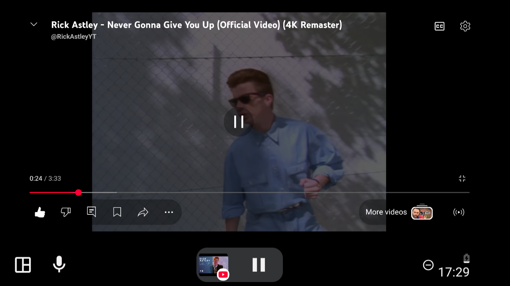
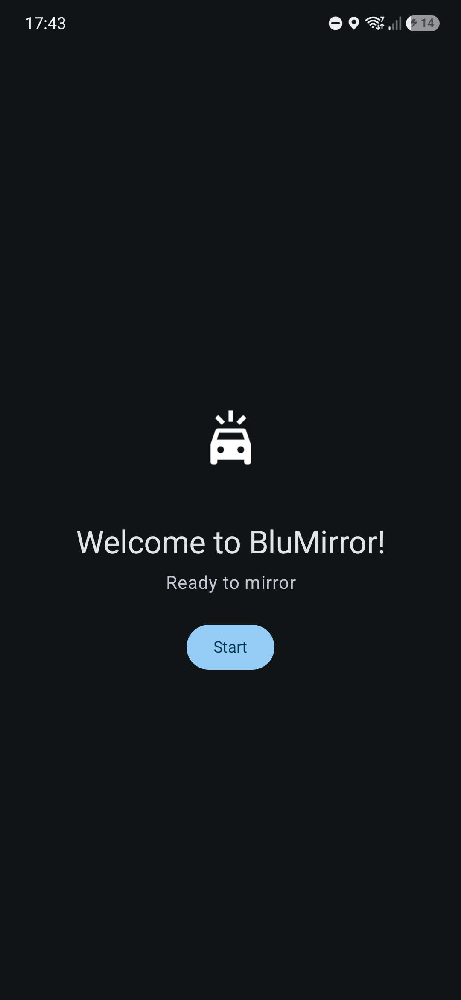
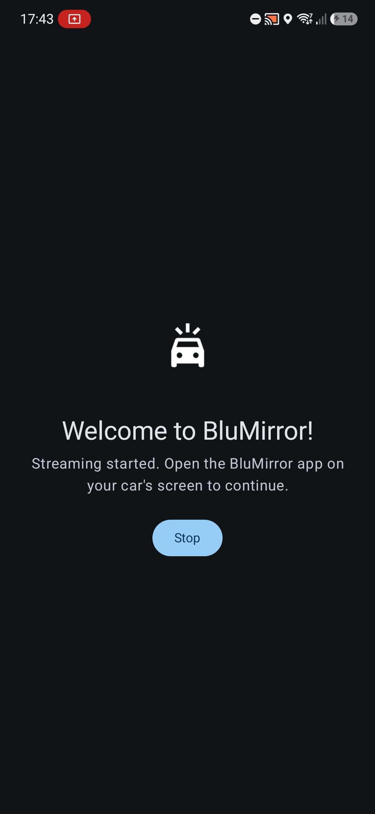
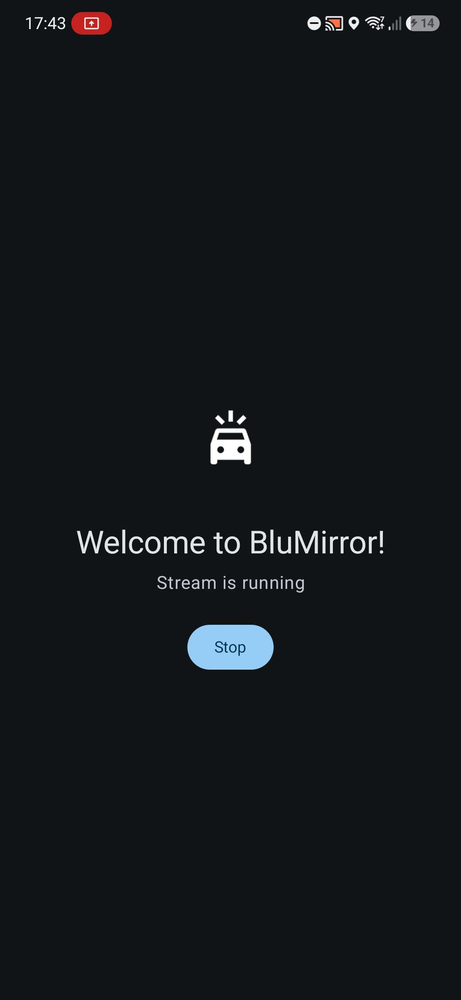
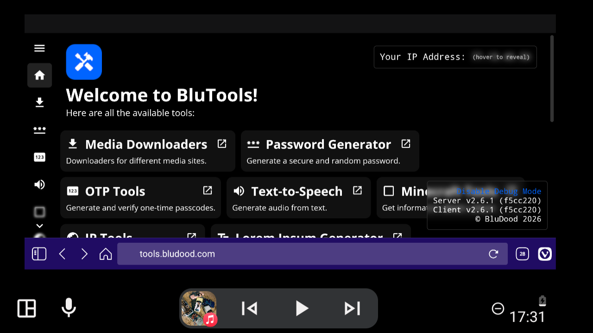

# BluMirror

Quickly and easily mirror your phone's screen to your car with Android Auto!

It mirrors your Android phone screen to Android Auto using Android’s built-in screen recording API, and uses an Android Auto surface to render the screen.



## Features

- Mirror your entire Android phone screen, or a specific app, to Android Auto
- Does not interfere with navigation apps
- Lightweight, minimal and fast interface
- Start and stop mirroring either from your phone or inside Android Auto (requires permission from the phone to start)
- **No Accessibility permissions, file access, or root required**

## Screenshots





## Safety notice

I do not condone or suggest anyone to use this application while driving, it is designed to be used while parked only, and you need to interact with your phone to start the stream.

**Please be mindful of other drivers and pay full attention to the road while driving!**

## Motivation

Many existing apps for mirroring your screen to Android Auto are either broken, bloated/slow, or require a lot of unnecessary and dangerous permissions (full filesystem access, displaying over other apps, accessibility, etc.). BluMirror is a simple, lightweight, and safe solution, with only screen recording permissions required. For example, this can be used to watch movies or YouTube videos while parked.

## Installation

Android Auto is very strict about sideloaded apps, so regular installation methods may not allow Android Auto to display the app in your car. Here are some options:

### 1. Install through BluApps (recommended)

BluApps will automatically install BluMirror using a compatibility mode that helps Android Auto recognize the app. Simply install the BluApps store, and install BluMirror from there. BluMirror should now be automatically recognized by Android Auto.

[Install BluApps from here](https://apps.bludood.com)

### 2. Manual installation

You can also download and install the APK manually using ADB, however your mileage may vary a lot. Regular sideloading methods (sideloading on the device, ADB, etc.) may not allow Android Auto to recognize the app on newer devices and versions.

[Download the APK from the releases page](https://github.com/BluDood/BluMirror/releases)

You can try to sideload the APK using ADB and specify Google Play Store as the "installation source" (although, this does not work on most devices):

```bash
# push APK to device
adb push BluMirror.apk /data/local/tmp/BluMirror.apk

# install APK with Google Play Store as the installation source
adb shell pm install -r -i "com.android.vending" /data/local/tmp/BluMirror.apk
```

In development, you can use Google’s Desktop Head Unit to test the app.
